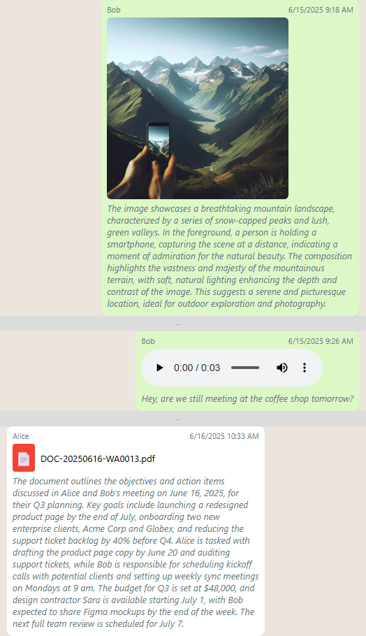

# WhatsApp Chat Viewer

> Forked from [rodrigodesalvobraz/whatsapp-chat-viewer](https://github.com/rodrigodesalvobraz/whatsapp-chat-viewer) with added support for iOS chat exports, system vs. regular message differentiation, sticky date badges, and bottom-right message timestamps. *(Updates generated with AI assistance and manually reviewed and tested.)*

WhatsApp's built-in chat export produces a plain text file and a folder of loose media files, which is hard to read and navigate. This tool generates a clean, browsable HTML page from that export, with embedded images, videos, audio players, PDFs, and optional audio transcriptions, and image and PDF descriptions. These latter elements are particularly useful for search and automatic processing of long conversations.



## What's New in This Fork

- **iOS Export Compatibility:** Supports iOS timestamp formatting (`[DD/MM/YYYY, HH:MM:SS] Sender: Message`), strips invisible Unicode directional characters (`\u200e`), and cleans `<attached: filename>` tags around media.
- **System vs. Regular Message Differentiation:** Automatically detects iOS system notices (such as end-to-end encryption banners and security code changes, which iOS exports under a contact's name) and renders them as centered system alerts rather than regular chat bubbles.
- **Sticky Date Badges:** Groups messages by day with centered, pill-style date headers (e.g., `10 Oct 2022`) that remain pinned below the top bar until the next day begins.
- **Bottom-Right Timestamps:** Moves the message time to the bottom-right corner inside each regular chat bubble (while keeping it inline for system notices) for a closer match to WhatsApp's native layout.

## Setup

```
pip install -r requirements.txt
```

For audio transcription, image descriptions, and PDF descriptions, set your OpenAI API key:

```
# Linux/macOS
export OPENAI_API_KEY="sk-..."

# Windows
setx OPENAI_API_KEY "sk-..."
```

## Usage

### Basic

```
python whatsapp_viewer.py --dir "path/to/chat/folder"
```

This expects a `chat.txt` file and media files inside the folder, and generates `output.html` there.

### Custom file names

```
python whatsapp_viewer.py "my_chat.txt" --dir "path/to/folder" --me "YourName"
```

The `--me` flag aligns your messages to the right.

### Message permalinks

Each rendered message gets a stable anchor id based on a hash of its date, time, sender, and text content. This lets you link directly to a specific message with a URL such as:

```
output.html#msg-1a2b3c4d5e6f
```

If two messages have identical content, the viewer appends a numeric suffix to keep the ids unique.

### Audio transcription

Transcribe all audio files using OpenAI's speech-to-text API:

```
python whatsapp_viewer.py "chat.txt" --dir "path/to/folder" --transcribe
```

Transcribe only the first N audios (useful for testing):

```
python whatsapp_viewer.py "chat.txt" --dir "path/to/folder" --transcribe --transcribe-only-x-audios 5
```

Transcriptions are cached as `.original.txt` files next to each audio file. Re-running the command skips already-transcribed audios.

### Transcription correction

Correct transcriptions using an LLM with conversation context:

```
python whatsapp_viewer.py "chat.txt" --dir "path/to/folder" --correct
```

Interactive mode lets you review each correction (accept, reject, or edit):

```
python whatsapp_viewer.py "chat.txt" --dir "path/to/folder" --correct-interactive --transcribe-only-x-audios 10
```

Corrected transcriptions are saved as `.txt` files. The original `.original.txt` files are preserved. The HTML output uses corrected versions when available.

### PDF descriptions

Generate a one-paragraph description for each PDF in the chat:

```
python whatsapp_viewer.py "chat.txt" --dir "path/to/folder" --describe-pdfs
```

Descriptions are displayed inline below the PDF link in the HTML output. The model uses the surrounding conversation context to focus on the most relevant information. Both text-based and scanned (image-only) PDFs are supported — scanned PDFs are rendered as images and processed with vision.

Descriptions are cached as `.pdf.txt` files next to each PDF. Re-running skips already-described files.

### Image descriptions

Generate a one-paragraph description for each image in the chat:

```
python whatsapp_viewer.py "chat.txt" --dir "path/to/folder" --describe-images
```

Descriptions are displayed inline below each image. Useful when images are photos of documents, receipts, or other important materials. The model uses the surrounding conversation context to highlight the most relevant information.

Descriptions are cached as `.img.txt` files next to each image. Re-running skips already-described files.

### All options

| Argument | Description |
|---|---|
| `chat_txt` | Chat text file (default: `chat.txt`) |
| `media_dir` | Media directory (default: `.`) |
| `output_html` | Output HTML file (default: `output.html`) |
| `--dir DIR` | Base directory for all files |
| `--me NAME` | Your name in the chat (right-aligns your messages) |
| `--transcribe` | Transcribe audio files using OpenAI API |
| `--transcribe-only-x-audios N` | Limit to first N audios/PDFs |
| `--stt-model MODEL` | Speech-to-text model (default: `gpt-4o-mini-transcribe`) |
| `--correct` | Correct transcriptions using LLM with conversation context |
| `--correct-interactive` | Interactively review each correction |
| `--llm-model MODEL` | LLM model for correction (default: `gpt-4o-mini`) |
| `--describe-pdfs` | Generate one-paragraph descriptions for PDF files |
| `--pdf-model MODEL` | Model for PDF description (default: `gpt-4o`) |
| `--describe-images` | Generate one-paragraph descriptions for image files |
| `--image-model MODEL` | Model for image description (default: `gpt-4o`) |

## Demo

A [`sample/`](sample/) directory is included with a short conversation between two fictional users, AI-generated images, audio files, and pre-generated transcriptions.

To generate the HTML yourself:

```
python whatsapp_viewer.py --dir sample --me Bob
```

Or browse the original project's pre-generated output directly (live rendered):

- [With transcriptions](https://rodrigodesalvobraz.github.io/whatsapp-chat-viewer/sample/output.html)
- [Without transcriptions](https://rodrigodesalvobraz.github.io/whatsapp-chat-viewer/sample/output-without-transcription.html)